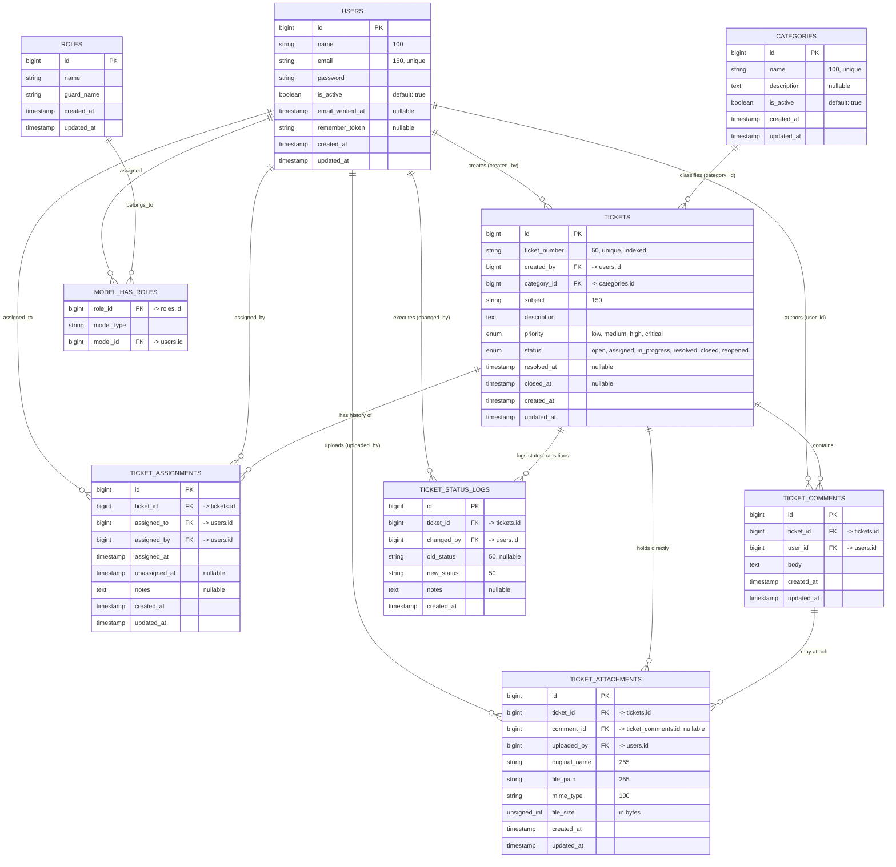

# DOKUMEN PERANCANGAN ENTITY RELATIONSHIP DIAGRAM (ERD)
## IT Helpdesk Management System — Versi 1.0

Dokumen ini merupakan artefak perancangan basis data relasional (*Relational Database Design*) untuk aplikasi **IT Helpdesk Management System**. Dokumen ini mencakup diagram visual Mermaid, kamus data atribut, kardinalitas relasi, serta aturan integritas referensial antar tabel.

---

## 1. Diagram Relasi Entitas (Visual ERD)

---

## 2. Kamus Data Entitas (Data Dictionary)

### 2.1 Tabel `users`
Menyimpan seluruh identitas pengguna sistem (Employee, IT Support, Administrator).

| Kolom | Tipe Data | Nullable | Keterangan |
| :--- | :--- | :---: | :--- |
| `id` | BIGINT UNSIGNED | Tidak | Primary Key (Auto Increment) |
| `name` | VARCHAR(100) | Tidak | Nama lengkap karyawan/petugas |
| `email` | VARCHAR(150) | Tidak | Alamat email unik (login username) |
| `password` | VARCHAR(255) | Tidak | Hash kata sandi (Bcrypt) |
| `is_active` | BOOLEAN | Tidak | Status aktif pengguna (Default: `1`/aktif) |
| `email_verified_at`| TIMESTAMP | Ya | Waktu verifikasi email |
| `remember_token` | VARCHAR(100) | Ya | Token sesi remember me |
| `created_at` | TIMESTAMP | Ya | Waktu pendaftaran akun |
| `updated_at` | TIMESTAMP | Ya | Waktu pembaruan profil |

---

### 2.2 Tabel `categories`
Master kategori kendala teknologi informasi yang dapat dipilih oleh pelapor.

| Kolom | Tipe Data | Nullable | Keterangan |
| :--- | :--- | :---: | :--- |
| `id` | BIGINT UNSIGNED | Tidak | Primary Key (Auto Increment) |
| `name` | VARCHAR(100) | Tidak | Nama kategori unik (misal: Hardware, Network) |
| `description` | TEXT | Ya | Penjelasan lingkup cakupan kategori |
| `is_active` | BOOLEAN | Tidak | Status pilihan kategori (Default: `1`/aktif) |
| `created_at` | TIMESTAMP | Ya | Waktu pembuatan kategori |
| `updated_at` | TIMESTAMP | Ya | Waktu terakhir kategori disunting |

---

### 2.3 Tabel `tickets`
Tabel transaksi utama pencatatan tiket kendala IT.

| Kolom | Tipe Data | Nullable | Keterangan |
| :--- | :--- | :---: | :--- |
| `id` | BIGINT UNSIGNED | Tidak | Primary Key (Auto Increment) |
| `ticket_number` | VARCHAR(50) | Tidak | Kode tiket unik berformat (`TICK-YYYYMM-XXXX`) |
| `created_by` | BIGINT UNSIGNED | Tidak | Foreign Key ke `users.id` (Pelapor) |
| `category_id` | BIGINT UNSIGNED | Tidak | Foreign Key ke `categories.id` (Kategori) |
| `subject` | VARCHAR(150) | Tidak | Ringkasan judul masalah (Maksimal 150 karakter) |
| `description` | TEXT | Tidak | Uraian lengkap kendala IT yang dialami |
| `priority` | ENUM | Tidak | Nilai: `'low'`, `'medium'`, `'high'`, `'critical'` |
| `status` | ENUM | Tidak | Nilai: `'open'`, `'assigned'`, `'in_progress'`, `'resolved'`, `'closed'`, `'reopened'` |
| `resolved_at` | TIMESTAMP | Ya | Waktu IT Support menandai tiket tuntas |
| `closed_at` | TIMESTAMP | Ya | Waktu tiket dikonfirmasi ditutup oleh pelapor |
| `created_at` | TIMESTAMP | Ya | Waktu pengiriman tiket |
| `updated_at` | TIMESTAMP | Ya | Waktu pembaruan data tiket |

---

### 2.4 Tabel `ticket_assignments`
Mencatat riwayat mutasi dan penugasan teknisi IT Support yang menangani tiket.

| Kolom | Tipe Data | Nullable | Keterangan |
| :--- | :--- | :---: | :--- |
| `id` | BIGINT UNSIGNED | Tidak | Primary Key (Auto Increment) |
| `ticket_id` | BIGINT UNSIGNED | Tidak | Foreign Key ke `tickets.id` |
| `assigned_to` | BIGINT UNSIGNED | Tidak | Foreign Key ke `users.id` (Petugas teknisi) |
| `assigned_by` | BIGINT UNSIGNED | Tidak | Foreign Key ke `users.id` (Admin/Aktor penugasan) |
| `assigned_at` | TIMESTAMP | Tidak | Waktu tiket mulai ditugaskan |
| `unassigned_at` | TIMESTAMP | Ya | Waktu penugasan selesai/dialihkan (NULL = aktif) |
| `notes` | TEXT | Ya | Catatan instruksi penugasan |
| `created_at` | TIMESTAMP | Ya | Timestamp pencatatan sistem |
| `updated_at` | TIMESTAMP | Ya | Timestamp pembaruan sistem |

---

### 2.5 Tabel `ticket_comments`
Media komunikasi dan pertukaran informasi teknis antara pelapor dan teknisi.

| Kolom | Tipe Data | Nullable | Keterangan |
| :--- | :--- | :---: | :--- |
| `id` | BIGINT UNSIGNED | Tidak | Primary Key (Auto Increment) |
| `ticket_id` | BIGINT UNSIGNED | Tidak | Foreign Key ke `tickets.id` |
| `user_id` | BIGINT UNSIGNED | Tidak | Foreign Key ke `users.id` (Penulis komentar) |
| `body` | TEXT | Tidak | Teks isi tanggapan / klarifikasi |
| `created_at` | TIMESTAMP | Ya | Waktu pengiriman komentar |
| `updated_at` | TIMESTAMP | Ya | Waktu pengeditan komentar |

---

### 2.6 Tabel `ticket_attachments`
Metadata berkas pendukung (tangkapan layar error, log file, dokumen PDF).

| Kolom | Tipe Data | Nullable | Keterangan |
| :--- | :--- | :---: | :--- |
| `id` | BIGINT UNSIGNED | Tidak | Primary Key (Auto Increment) |
| `ticket_id` | BIGINT UNSIGNED | Tidak | Foreign Key ke `tickets.id` |
| `comment_id` | BIGINT UNSIGNED | Ya | Foreign Key ke `ticket_comments.id` (NULL jika lampiran tiket awal) |
| `uploaded_by` | BIGINT UNSIGNED | Tidak | Foreign Key ke `users.id` (Pengunggah) |
| `original_name`| VARCHAR(255) | Tidak | Nama berkas asli saat diunggah |
| `file_path` | VARCHAR(255) | Tidak | Lokasi direktori penyimpanan privat di storage |
| `mime_type` | VARCHAR(100) | Tidak | MIME type (`image/png`, `application/pdf`, dll) |
| `file_size` | INT UNSIGNED | Tidak | Ukuran berkas dalam satuan Bytes (Maks 5 MB) |
| `created_at` | TIMESTAMP | Ya | Waktu unggah berkas |
| `updated_at` | TIMESTAMP | Ya | Waktu pembaruan berkas |

---

### 2.7 Tabel `ticket_status_logs`
Tabel jejak audit (*Audit Trail*) yang bersifat permanen (*immutable*) untuk mencatat setiap pergantian status tiket.

| Kolom | Tipe Data | Nullable | Keterangan |
| :--- | :--- | :---: | :--- |
| `id` | BIGINT UNSIGNED | Tidak | Primary Key (Auto Increment) |
| `ticket_id` | BIGINT UNSIGNED | Tidak | Foreign Key ke `tickets.id` |
| `changed_by` | BIGINT UNSIGNED | Tidak | Foreign Key ke `users.id` (Eksekutor aksi) |
| `old_status` | VARCHAR(50) | Ya | Status tiket sebelumnya (NULL saat tiket baru) |
| `new_status` | VARCHAR(50) | Tidak | Status tiket yang baru diberlakukan |
| `notes` | TEXT | Ya | Alasan perubahan / catatan solusi |
| `created_at` | TIMESTAMP | Tidak | Waktu mutasi status dieksekusi |

---

## 3. Matriks Relasi & Kardinalitas Antar Entitas

| Entitas Asal | Entitas Tujuan | Jenis Kardinalitas | Atribut Penghubung (FK) | Aksi onDelete |
| :--- | :--- | :---: | :--- | :--- |
| `users` | `tickets` | 1 to Many (1:N) | `tickets.created_by` | `CASCADE` |
| `categories` | `tickets` | 1 to Many (1:N) | `tickets.category_id` | `RESTRICT` *(Cegah hapus jika berelasi)* |
| `tickets` | `ticket_assignments` | 1 to Many (1:N) | `ticket_assignments.ticket_id` | `CASCADE` |
| `users` | `ticket_assignments` | 1 to Many (1:N) | `ticket_assignments.assigned_to` | `CASCADE` |
| `tickets` | `ticket_comments` | 1 to Many (1:N) | `ticket_comments.ticket_id` | `CASCADE` |
| `users` | `ticket_comments` | 1 to Many (1:N) | `ticket_comments.user_id` | `CASCADE` |
| `tickets` | `ticket_attachments` | 1 to Many (1:N) | `ticket_attachments.ticket_id` | `CASCADE` |
| `ticket_comments`| `ticket_attachments` | 1 to Many (1:N) | `ticket_attachments.comment_id` | `CASCADE` |
| `tickets` | `ticket_status_logs` | 1 to Many (1:N) | `ticket_status_logs.ticket_id` | `CASCADE` |
| `users` | `ticket_status_logs` | 1 to Many (1:N) | `ticket_status_logs.changed_by` | `CASCADE` |

---

## 4. Aturan Integritas Data & Logika Bisnis Basis Data

1. **Aturan Penugasan Tunggal (*Single Active Assignment*):**
   Pada tabel `ticket_assignments`, hanya boleh ada maksimal satu baris penugasan per `ticket_id` yang memiliki nilai `unassigned_at IS NULL`. Ketika tiket dialihkan ke petugas lain, sistem wajib mengisi timestamp `unassigned_at` pada penugasan lama terlebih dahulu.
2. **Proteksi Referensial Kategori (`RESTRICT`):**
   Relasi `categories` ke `tickets` menggunakan aturan `restrictOnDelete`. Hal ini menjamin integritas histori data bahwa kategori kendala yang sudah pernah digunakan oleh suatu tiket tidak dapat dihapus secara fisik dari basis data.
3. **Penyimpanan Lampiran Dua Jalur:**
   Tabel `ticket_attachments` memiliki `comment_id` yang bernilai *nullable*. Jika berkas dilampirkan saat pembuatan tiket pertama kali, `comment_id` bernilai `NULL`. Jika berkas diunggah saat berbalas tanggapan, `comment_id` berelasi langsung ke komentar terkait.
4. **Log Riwayat Tak Dapat Dimanipulasi (*Immutable*):**
   Tabel `ticket_status_logs` tidak menyediakan kolom `updated_at` karena setiap catatan transisi status merupakan fakta audit historis yang tidak boleh diedit kembali oleh pengguna mana pun.
