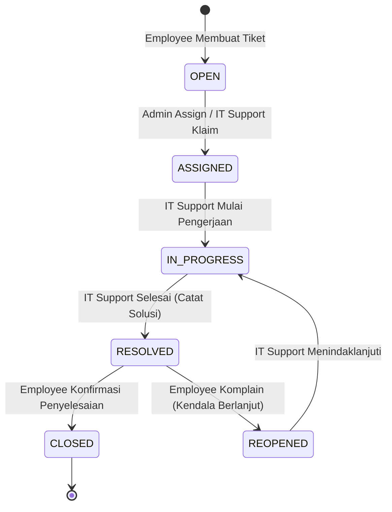
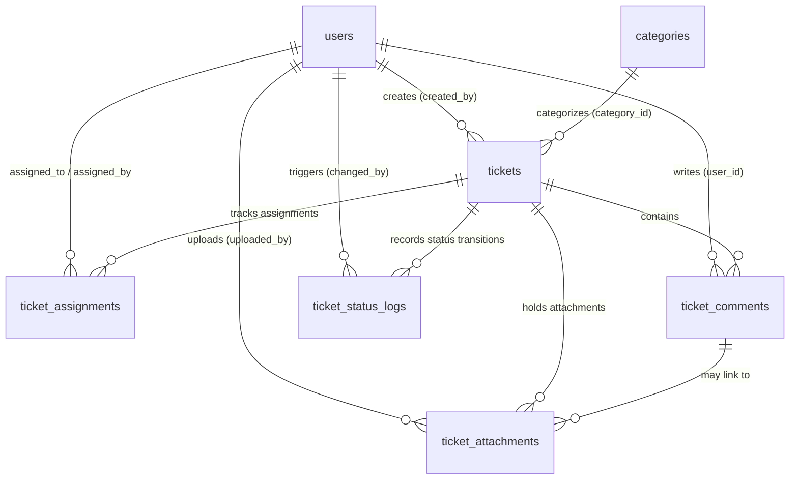

# PRODUCT REQUIREMENTS DOCUMENT (PRD)
# IT Helpdesk Management System

| Informasi | Detail |
| :--- | :--- |
| **Nama Produk** | IT Helpdesk Management System |
| **Versi Dokumen** | 1.0 |
| **Status** | Draft untuk pengembangan |
| **Jenis Produk** | Aplikasi web internal perusahaan |
| **Durasi Pengembangan** | 1 bulan (20 hari kerja) |
| **Tim Pengembang** | 1–2 peserta magang |
| **Product Owner** | Pembimbing / Perwakilan IT |
| **Target Pengguna** | Employee, IT Support, Administrator |

---

## 1. Ringkasan Produk

**IT Helpdesk Management System** adalah aplikasi web internal untuk mencatat, mengelola, menugaskan, memantau, dan menyelesaikan laporan kendala teknologi informasi yang disampaikan karyawan perusahaan.

Aplikasi memusatkan proses pelaporan kendala ke dalam sistem tiket sehingga setiap laporan memiliki nomor tiket unik, kategori, tingkat prioritas, penanggung jawab, status penanganan terkini, riwayat komunikasi, serta jejak audit lengkap.

---

## 2. Latar Belakang dan Permasalahan

Penanganan kendala IT yang dilakukan melalui saluran komunikasi informal (seperti chat personal, telepon langsung, atau memo lisan) menimbulkan risiko:
- Laporan keluhan tercecer atau terlambat ditindaklanjuti.
- Status progres pekerjaan tidak transparan bagi karyawan pelapor.
- Riwayat penugasan dan beban kerja staf IT Support tidak tercatat secara terukur.
- Kesulitan dalam menyusun laporan rekapitulasi dan evaluasi kinerja divisi IT.

Sistem ini dibangun untuk menyediakan satu pintu pencatatan, penanganan, dan pemantauan kendala IT secara tersentralisasi dan terstruktur.

---

## 3. Tujuan Produk

1. Menyediakan sarana pelaporan kendala IT mandiri bagi seluruh karyawan.
2. Memastikan setiap laporan tercatat dengan nomor tiket unik secara otomatis.
3. Memudahkan IT Support dalam mengelola antrean, menindaklanjuti, dan menyelesaikan tiket.
4. Menyediakan transparansi status dan riwayat penanganan bagi pelapor maupun manajemen.
5. Menyediakan ringkasan metrik dan laporan tiket yang dapat diekspor untuk Administrator.

---

## 4. Ruang Lingkup

### 4.1 In Scope — Wajib (Versi 1.0)

- Autentikasi login dan logout.
- Manajemen role dan pembatasan hak akses berbasis otorisasi.
- Dashboard berbasis role (Employee, IT Support, Admin).
- Manajemen kategori kendala IT (aktif/nonaktif).
- Pembuatan tiket dengan validasi form ketat.
- Penomoran tiket otomatis dan unik.
- Pengaturan skala prioritas tiket.
- Penugasan tiket kepada IT Support (penugasan oleh Admin & klaim mandiri).
- Siklus hidup dan transisi status tiket yang ketat.
- Komunikasi dua arah melalui komentar tiket.
- Unggah berkas lampiran (JPG, JPEG, PNG, PDF maks 5 MB).
- Pencatatan solusi penyelesaian dan konfirmasi penutupan tiket.
- Audit trail riwayat perubahan status dan mutasi penugasan.
- Pencarian dan multi-filter tiket.
- Laporan rekapitulasi dan export data ke format Excel (.xlsx).
- Validasi input di sisi server dan pengujian fungsional terstruktur.

### 4.2 Out of Scope — Tidak Dikerjakan pada Versi 1.0

- Integrasi notifikasi pihak ketiga (WhatsApp, Telegram, SMS Gateway).
- Notifikasi push atau real-time eksternal (WebPush / FCM).
- Perhitungan Service Level Agreement (SLA) otomatis dan eskalasi bertingkat otomatis.
- Integrasi ke database inventaris aset/perangkat keras perusahaan (CMDB/ITAM).
- Integrasi Single Sign-On (SSO), Active Directory, atau LDAP.
- Aplikasi mobile native (iOS / Android).
- Kecerdasan buatan (AI) untuk kategorisasi otomatis maupun auto-reply.
- Modul survei kepuasan pelanggan lanjutan (CSAT) dan analitik prediktif.
- Dukungan multi-company atau multi-tenant.

---

## 5. Pengguna dan Hak Akses

Sistem membedakan tiga role pengguna utama dengan pembatasan hak akses berbasis kebijakan (*Role-Based Access Control*).

### 5.1 Employee
Karyawan umum yang mengalami kendala IT:
- Login dan logout.
- Mengakses dashboard ringkasan tiket miliknya.
- Membuat laporan kendala (tiket baru).
- Melihat daftar dan detail tiket miliknya sendiri.
- Memberikan komentar dan lampiran tambahan pada tiketnya selama belum berstatus `CLOSED`.
- Melihat status dan riwayat penanganan tiket miliknya.
- Mengonfirmasi tiket `RESOLVED` menjadi `CLOSED`.
- Mengajukan pembukaan ulang (`REOPENED`) jika kendala belum tuntas diselesaikan.

### 5.2 IT Support
Petugas teknis divisi IT yang bertugas menyelesaikan kendala:
- Login dan logout.
- Mengakses dashboard operasional penanganan.
- Melihat daftar tiket yang ditugaskan kepadanya.
- Melihat daftar tiket baru yang belum memiliki penanggung jawab.
- Mengambil (*self-assign*) tiket terbuka yang belum ditugaskan.
- Mengubah status penanganan tiket yang menjadi tanggung jawabnya.
- Berinteraksi dengan pelapor melalui komentar dan melampirkan berkas bukti perbaikan.
- Mengisi formulir catatan solusi teknis saat penyelesaian kendala.
- Mengakses log riwayat penanganan tiket terkait.

### 5.3 Administrator
Pengelola utama sistem dan supervisor operasional IT:
- Mengakses dashboard metrik operasional menyeluruh.
- Mengelola data master pengguna (User Management).
- Mengelola data master kategori kendala.
- Memantau seluruh tiket di dalam organisasi tanpa batasan status/penugasan.
- Menugaskan tiket kepada IT Support atau mengalihkan petugas (*reassign*).
- Memantau log audit dan riwayat perubahan status secara komprehensif.
- Mengakses laporan analitik dan mengekspor data ke format Excel.
- Mengelola konfigurasi dasar aplikasi.

### 5.4 Matriks Hak Akses

| Fitur / Tindakan | Employee | IT Support | Administrator |
| :--- | :---: | :---: | :---: |
| **Dashboard** | Khusus tiket sendiri | Antrean & penanganan pribadi | Ringkasan organisasi penuh |
| **Buat Tiket** | Ya | Tidak | Opsional (bantuan teknis) |
| **Lihat Daftar Tiket** | Khusus tiket sendiri | Tiket ditangani & tiket unassigned | Seluruh tiket |
| **Kelola Kategori** | Tidak | Tidak | Ya (Penuh) |
| **Penugasan (Assign)** | Tidak | Klaim tiket unassigned | Menugaskan & ubah petugas |
| **Update Status** | Konfirmasi Close / Reopen | Ya (sesuai alur penanganan) | Ya (override administratif) |
| **Komentar** | Khusus tiket sendiri | Khusus tiket yang ditangani | Seluruh tiket |
| **Lampiran** | Khusus tiket sendiri | Khusus tiket yang ditangani | Seluruh tiket |
| **Kelola Pengguna** | Tidak | Tidak | Ya |
| **Laporan & Export** | Tidak | Terbatas pada tiket pribadi | Seluruh tiket |

---

## 6. Kebutuhan Fungsional

### FR-01 — Autentikasi & Otorisasi
- Autentikasi sesi standar berbasis web (Login & Logout).
- Seluruh rute dan aksi controller/komponen diproteksi middleware autentikasi.
- Hak akses dipisahkan menggunakan *permission gates/policies*.
- Proteksi terhadap akses ilegal (pengguna dicegah mengakses ID tiket pihak lain via URL tampering).

### FR-02 — Dashboard
- **Employee:** Total tiket dibuat, hitungan tiket *Open*, *In Progress*, *Resolved*, dan tabel tiket terkini.
- **IT Support:** Total tiket aktif yang ditugaskan, tiket belum dikerjakan (*Assigned*), tiket *In Progress*, tiket *Resolved*, dan antrean kerja prioritas.
- **Administrator:** Metrik komprehensif (Open, Assigned, In Progress, Resolved, Closed, Reopened), distribusi berdasarkan kategori, serta grafik tren periode.

### FR-03 — Manajemen Kategori Kendala
- Administrator dapat menambah, mengubah, mengaktifkan, atau menonaktifkan kategori.
- Kategori awal: `Hardware`, `Software`, `Network`, `Printer`, `Account & Access`, `Other`.
- Nama kategori harus unik. Kategori nonaktif tidak boleh dipilih saat pembuatan tiket baru.
- Kategori yang sudah berelasi dengan tiket tidak boleh dihapus secara fisik (*soft/status toggle* saja).

### FR-04 — Pembuatan Tiket Baru
Formulir pembuatan tiket memuat atribut:

| Atribut | Tipe Data | Aturan Validasi |
| :--- | :--- | :--- |
| **Ticket Number** | String | Dihasilkan sistem otomatis (contoh: `TICK-202611-0001`), unik |
| **Subject** | String | Wajib, maksimal 150 karakter |
| **Category** | Foreign Key | Wajib, hanya kategori yang berstatus aktif |
| **Priority** | Enum | Wajib: `low`, `medium`, `high`, `critical` |
| **Description** | Text | Wajib, penjelasan rinci kendala |
| **Attachment** | File | Opsional, format JPG/JPEG/PNG/PDF, maks 5 MB |
| **Created By** | Foreign Key | Diambil otomatis dari ID pengguna yang terautentikasi |
| **Status Awal** | Enum | Otomatis diset ke `OPEN` |

### FR-05 — Daftar & Detail Tiket
- Tampilan daftar dilengkapi pencarian teks (nomor tiket & subjek), multi-filter (kategori, status, prioritas, rentang tanggal), pagination, dan sorting waktu.
- Halaman detail menyajikan data tiket, biodata pelapor & teknisi, preview lampiran, timeline komentar, riwayat transisi status, serta riwayat mutasi penugasan.

### FR-06 — Penugasan Tiket (Assignment)
- Tiket `OPEN` dapat diambil langsung oleh staf IT Support atau ditugaskan oleh Administrator.
- Saat penugasan disetujui, status tiket otomatis berubah menjadi `ASSIGNED`.
- Mutasi penugasan baru mencatat riwayat di `ticket_assignments` dengan menutup record sebelumnya (`unassigned_at`).
- Sistem mencegah adanya lebih dari satu petugas aktif secara bersamaan pada tiket yang sama.

### FR-07 — Pengelolaan Alur Status Tiket

- **OPEN**: Tiket baru tersimpan dan menunggu penugasan.
- **ASSIGNED**: Tiket telah memiliki penanggung jawab teknisi.
- **IN_PROGRESS**: Petugas aktif sedang melakukan pemeriksaan atau perbaikan.
- **RESOLVED**: Petugas menyatakan pekerjaan selesai dan mencantumkan deskripsi solusi.
- **CLOSED**: Pelapor mengonfirmasi kendala tuntas atau tiket ditutup permanen.
- **REOPENED**: Pelapor menyatakan kendala belum teratasi.

> [!IMPORTANT]
> Setiap transisi status wajib dicatat ke dalam tabel `ticket_status_logs` mencakup status lama, status baru, aktor pelaksana, catatan/alasan perubahan, dan timestamp.

### FR-08 — Interaksi Komentar
- Media komunikasi terpusat antara pelapor dan teknisi.
- Komentar terkunci secara otomatis apabila tiket telah berstatus `CLOSED`.
- Riwayat komentar ditampilkan kronologis urut waktu (terlama ke terbaru).

### FR-09 — Pengelolaan Berkas Lampiran
- Mendukung berkas gambar (`image/jpeg`, `image/png`) dan dokumen PDF (`application/pdf`).
- Batas ukuran maksimal: 5 MB per berkas.
- Berkas disimpan pada direktori privat non-publik; akses unduhan divalidasi melalui controller/route bertanda tangan (*authorized download stream*).

### FR-10 — Penyelesaian Tiket (Resolution)
- IT Support wajib menginput ringkasan tindakan perbaikan saat memicu status `RESOLVED`.
- Waktu `resolved_at` dicatat ke dalam database.
- Employee menerima pemberitahuan visual untuk memberikan konfirmasi tutup (*Close*) atau buka kembali (*Reopen*).

### FR-11 — Pelaporan & Export Data
- Administrator dapat memfilter data tiket berdasarkan periode tanggal, status, prioritas, kategori, dan staf teknisi penanggung jawab.
- Fitur export menghasilkan berkas spreadsheet (.xlsx) yang siap diunduh.

### FR-12 — Jejak Audit (Audit History)
- Menyediakan log historis yang tidak dapat diubah (*immutable*) atas seluruh aktivitas krusial pada tiket untuk kebutuhan akuntabilitas dan audit internal.

---

## 7. Model Data dan Arsitektur Database

### 7.1 Entity Relationship Diagram (ERD)

### 7.2 Spesifikasi Tabel Basis Data

#### 1. `users`
Tabel pengguna aplikasi terintegrasi dengan Spatie Laravel Permission.
- `id` (BigIncrements, PK)
- `name` (String, 100)
- `email` (String, 150, Unique)
- `password` (String)
- `is_active` (Boolean, default true)
- `email_verified_at` (Timestamp, nullable)
- `remember_token` (String, nullable)
- `created_at`, `updated_at` (Timestamps)

#### 2. `categories`
Master kategori masalah IT.
- `id` (BigIncrements, PK)
- `name` (String, 100, Unique)
- `description` (Text, nullable)
- `is_active` (Boolean, default true)
- `created_at`, `updated_at` (Timestamps)

#### 3. `tickets`
Tabel transaksi utama tiket laporan kendala.
- `id` (BigIncrements, PK)
- `ticket_number` (String, 50, Unique)
- `created_by` (BigInteger, FK ke `users.id`)
- `category_id` (BigInteger, FK ke `categories.id`)
- `subject` (String, 150)
- `description` (Text)
- `priority` (Enum: `low`, `medium`, `high`, `critical`)
- `status` (Enum: `open`, `assigned`, `in_progress`, `resolved`, `closed`, `reopened`)
- `resolved_at` (Timestamp, nullable)
- `closed_at` (Timestamp, nullable)
- `created_at`, `updated_at` (Timestamps)

#### 4. `ticket_assignments`
Pencatatan penugasan tiket dan riwayat pergantian teknisi.
- `id` (BigIncrements, PK)
- `ticket_id` (BigInteger, FK ke `tickets.id`, onDelete cascade)
- `assigned_to` (BigInteger, FK ke `users.id`)
- `assigned_by` (BigInteger, FK ke `users.id`)
- `assigned_at` (Timestamp)
- `unassigned_at` (Timestamp, nullable)
- `notes` (Text, nullable)
- `created_at`, `updated_at` (Timestamps)

#### 5. `ticket_comments`
Daftar percakapan dan klarifikasi pada tiket.
- `id` (BigIncrements, PK)
- `ticket_id` (BigInteger, FK ke `tickets.id`, onDelete cascade)
- `user_id` (BigInteger, FK ke `users.id`)
- `body` (Text)
- `created_at`, `updated_at` (Timestamps)

#### 6. `ticket_attachments`
Metadata berkas lampiran pendukung tiket maupun komentar.
- `id` (BigIncrements, PK)
- `ticket_id` (BigInteger, FK ke `tickets.id`, onDelete cascade)
- `comment_id` (BigInteger, nullable, FK ke `ticket_comments.id`, onDelete cascade)
- `uploaded_by` (BigInteger, FK ke `users.id`)
- `original_name` (String, 255)
- `file_path` (String, 255)
- `mime_type` (String, 100)
- `file_size` (UnsignedInteger, dalam Bytes)
- `created_at`, `updated_at` (Timestamps)

#### 7. `ticket_status_logs`
Tabel audit trail mutasi status tiket.
- `id` (BigIncrements, PK)
- `ticket_id` (BigInteger, FK ke `tickets.id`, onDelete cascade)
- `changed_by` (BigInteger, FK ke `users.id`)
- `old_status` (String, 50, nullable)
- `new_status` (String, 50)
- `notes` (Text, nullable)
- `created_at` (Timestamp)

#### 8. Skema Otorisasi Spatie
Menggunakan migrasi standar paket `spatie/laravel-permission`:
- `roles`, `permissions`, `model_has_roles`, `model_has_permissions`, `role_has_permissions`.

---

## 8. Aturan Bisnis (Business Rules)

1. **Nomor Unik:** Nomor tiket digenerasi oleh sistem dengan format standar tak berulang (`TICK-YYYYMM-XXXX`).
2. **Kategori Aktif:** Tiket hanya dapat dibuat dengan kategori yang berstatus `is_active = true`.
3. **Single Active Assignment:** Pada satu waktu, hanya ada maksimal 1 record penugasan dengan `unassigned_at = NULL` per tiket.
4. **Isolasi Data Karyawan:** Employee hanya diizinkan melihat dan memanipulasi tiket yang ia ciptakan sendiri.
5. **Kunci Tiket Selesai:** Tiket dengan status `CLOSED` dibekukan dari penambahan komentar baru maupun modifikasi status reguler.
6. **Mekanisme Reopen:** Hanya tiket dengan status `RESOLVED` yang dapat di-reopen oleh pelapor.
7. **Integritas Referensial:** Kategori yang telah memiliki referensi tiket tidak dapat dihapus permanen, hanya dinonaktifkan statusnya.
8. **Konsistensi Zona Waktu:** Seluruh pencatatan dan visualisasi waktu diseragamkan mengikuti konfigurasi timezone internal aplikasi (misal: `Asia/Jakarta`).

---

## 9. Kebutuhan Non-Fungsional (NFR)

- **Keamanan (Security):**
  - Penyimpanan kata sandi wajib menggunakan algoritma bcrypt/argon2 bawaan Laravel.
  - Otorisasi ganda via Policy & Gate pada setiap aksi mutating di backend.
  - Validasi ketat terhadap ekstensi, MIME type, dan ukuran file unggahan untuk mencegah injeksi web-shell.
  - Proteksi CSRF bawaan aktif pada seluruh interaksi form.
  - Berkas lampiran disimpan pada disk non-publik (`storage/app/private/tickets`).
- **Kinerja (Performance):**
  - Implementasi eager loading (`with(...)`) pada query relasi guna memitigasi isu *N+1 Query*.
  - Indeks database pada kolom `status`, `category_id`, `created_by`, dan `created_at`.
  - Agregasi dashboard dihitung langsung melalui query agregasi SQL (`COUNT(*) WHERE...`), bukan memuat seluruh koleksi model ke memori PHP.
- **Usabilitas (Usability):**
  - Desain antarmuka responsif (Mobile Friendly) menggunakan utilitas Tailwind CSS.
  - Komponen form dilengkapi umpan balik validasi error yang jelas per field.
  - Indikator status dan badge prioritas dibedakan dengan warna tematik yang konsisten.
- **Keterpeliharaan (Maintainability):**
  - Mengikuti standar PSR-12 dan konvensi Clean Code arsitektur MVC Laravel.
  - Pemisahan logika bisnis menggunakan Service/Action Class atau Form Request terdedikasi.
  - Seluruh riwayat pengembangan dikelola melalui Git dengan commit message deskriptif.

---

## 10. Spesifikasi Arsitektur & Teknologi

| Lapisan Sistem | Pilihan Teknologi |
| :--- | :--- |
| **Framework Backend** | PHP 8.2+ / Laravel 11.x |
| **Komponen Reaktif** | Livewire 3 (Class-based components) |
| **Template Engine & Styling** | Blade Engine & Tailwind CSS |
| **Basis Data** | MySQL 8.0+ / MariaDB 10.5+ |
| **Autentikasi** | Laravel Breeze / Laravel Fortify Session Auth |
| **Otorisasi & Role** | Spatie Laravel Permission |
| **Export Engine** | Maatwebsite/Laravel-Excel atau Spatie Simple-Excel |
| **Testing Suite** | Pest PHP / PHPUnit |
| **Version Control** | Git & GitHub / GitLab |

---

## 11. Rencana Pelaksanaan Pengerjaan (20 Hari Kerja)

```mermaid
flowchart TD
    subgraph W1["Minggu 1: Fondasi & Basis Data"]
        D1["Hari 1: Analisis Kebutuhan"] --> D2["Hari 2: Perancangan ERD"]
        D2 --> D3["Hari 3: Inisialisasi Proyek & Auth"]
        D3 --> D4["Hari 4: Migration, Model & Relasi"]
        D4 --> D5["Hari 5: Konfigurasi Role & Permission"]
    end
    subgraph W2["Minggu 2: Modul Utama Tiket"]
        D5 --> D6["Hari 6: CRUD Master Kategori"]
        D6 --> D7["Hari 7: Form Pembuatan Tiket"]
        D7 --> D8["Hari 8: Daftar & Detail Tiket"]
        D8 --> D9["Hari 9: Alur Penugasan Teknisi"]
        D9 --> D10["Hari 10: Workflow Status Tiket"]
    end
    subgraph W3["Minggu 3: Fitur Interaktif & Resolusi"]
        D10 --> D11["Hari 11: Modul Komentar"]
        D11 --> D12["Hari 12: Manajemen Lampiran Berkas"]
        D12 --> D13["Hari 13: Workflow Penyelesaian & Reopen"]
        D13 --> D14["Hari 14: Dashboard Metrik Statistik"]
        D14 --> D15["Hari 15: Pencarian & Multi-Filter"]
    end
    subgraph W4["Minggu 4: Pelaporan & Finalisasi"]
        D15 --> D16["Hari 16: Modul Rekap & Export Excel"]
        D16 --> D17["Hari 17: Pengujian Menyeluruh (Testing)"]
        D17 --> D18["Hari 18: Stabilisasi & Bug Fixing"]
        D18 --> D19["Hari 19: Penyusunan User Manual & Dokumentasi"]
        D19 --> D20["Hari 20: Final Delivery & Presentasi"]
    end
```

---

## 12. Kriteria Penerimaan Produk (Acceptance Criteria)

| ID | Kriteria Penerimaan | Verifikasi yang Diharapkan |
| :--- | :--- | :--- |
| **AC-01** | Login & Logout | Pengguna berhasil masuk dan keluar dari sesi dengan aman |
| **AC-02** | Otorisasi Role | Pengguna hanya dapat mengakses fitur sesuai hak aksesnya |
| **AC-03** | Manajemen Kategori | Admin dapat mengelola kategori; kategori nonaktif tak dapat dipilih |
| **AC-04** | Pembuatan Tiket | Employee dapat submit tiket dengan validasi form server-side |
| **AC-05** | Penomoran Tiket | Nomor tiket unik terbuat otomatis oleh sistem |
| **AC-06** | Isolasi Akses Tiket | Employee hanya melihat tiket miliknya sendiri |
| **AC-07** | Penugasan | Tiket dapat ditugaskan ke teknisi dan tercatat di riwayat |
| **AC-08** | Alur Status | Perubahan status wajib menaati state machine yang valid |
| **AC-09** | Interaksi Komentar | Komentar tersimpan kronologis dan terkunci saat status Closed |
| **AC-10** | Berkas Lampiran | File valid terunggah dan terlindungi dari akses non-otorisasi |
| **AC-11** | Resolusi Masalah | IT Support dapat menyelesaikan tiket dengan mencatat catatan solusi |
| **AC-12** | Pembukaan Ulang | Employee dapat mengajukan reopen pada tiket yang berstatus Resolved |
| **AC-13** | Dashboard Metrik | Data kartu statistik akurat sesuai role dan agregasi basis data |
| **AC-14** | Filter & Cari | Pencarian dan multi-filter menghasilkan record yang tepat |
| **AC-15** | Export Excel | File .xlsx terunduh sesuai parameter filter yang aktif |
| **AC-16** | Jejak Audit | Mutasi status dan pergantian petugas tercatat di tabel log |
| **AC-17** | UI Responsif | Layout dapat dioperasikan nyaman di perangkat bergerak (ponsel) |
| **AC-18** | Kelengkapan Dokumen | Panduan instalasi, manual penggunaan, dan ERD tersedia lengkap |

---

## 13. Deliverables Proyek Magang

1. Repositori Git berisi source code lengkap dan riwayat commit teratur.
2. Skrip migrasi database lengkap beserta database seeder akun uji coba.
3. Dokumen PRD final (v1.0).
4. Diagram ERD dan dokumentasi relasi basis data.
5. Dokumen spesifikasi skenario pengujian (*Test Cases & Results*).
6. Buku petunjuk penggunaan aplikasi (*User Manual*).
7. Berkas `README.md` berisikan instruksi instalasi dan konfigurasi lokal.
8. Laporan teknis akhir program magang.

---

> [!NOTE]
> **Keputusan Teknis yang Perlu Dikonfirmasi Sebelum Sprint Mulai:**
> - Versi PHP minimum (direkomendasikan PHP 8.2+).
> - Kebijakan pembuatan akun: Apakah self-registration diperbolehkan bagi karyawan atau didaftarkan terpusat oleh Administrator/HRD.
> - Batas waktu maksimal (*auto-close timeout*) jika tiket `RESOLVED` tidak dikonfirmasi oleh pelapor dalam waktu tertentu.
